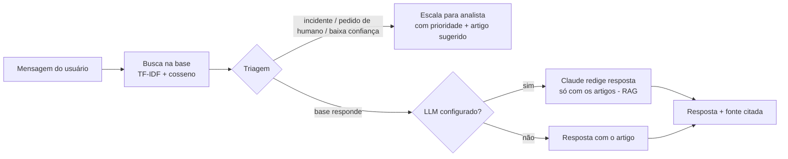

# 🤖 Agente de Suporte com IA (RAG + triagem)

[](https://github.com/rafacampanha/agente-suporte-ia/actions/workflows/testes.yml)

Agente de **suporte técnico de 1º nível** que responde dúvidas com base numa **base de conhecimento**, decide a **prioridade** do caso e sabe a hora de **escalar para um humano**. Funciona offline (busca TF-IDF) e, com uma chave de API, usa um **LLM (Claude)** para redigir a resposta só com o que está nos artigos (RAG), sem inventar.

> Versão genérica, com base de conhecimento fictícia, de um agente de suporte em que trabalho (integrado ao Jira Service Management). Nenhum dado real da empresa ou de clientes está aqui.

## Como funciona



## Exemplo

```text
Você: esqueci minha senha
Agente: Como redefinir minha senha:
Acesse a tela de login e clique em 'Esqueci minha senha'. [...]
[KB-001]
  ↳ prioridade=Baixa escalar=False fontes=['KB-001']

Você: o sistema está fora do ar para todos
Agente: Vou encaminhar seu caso para um analista (possível incidente afetando vários usuários). Prioridade definida: Crítica.
Enquanto isso, este artigo pode ajudar: Sistema lento ou fora do ar [KB-006]

Você: qual a previsão do tempo?
Agente: Vou encaminhar seu caso para um analista (nenhum artigo da base responde com confiança).
```

## Estrutura

| Arquivo | Papel |
|---|---|
| `base/artigos.json` | Base de conhecimento (fictícia). Basta trocar pelos seus artigos |
| `agente/base_conhecimento.py` | Indexação e busca (TF-IDF com bigramas, sem acento) |
| `agente/triagem.py` | Regras de prioridade (Crítica/Alta/Baixa) e de escalonamento |
| `agente/agente.py` | Orquestra busca → triagem → resposta (offline ou LLM) e o chat no terminal |
| `tests/` | Testes da busca, da triagem e das respostas |

## Como rodar

```bash
pip install -r requirements.txt
python -m agente.agente          # chat no terminal (modo offline)
pytest

# opcional: respostas redigidas pelo Claude
pip install anthropic
export ANTHROPIC_API_KEY=...     # nunca suba a chave para o GitHub
python -m agente.agente
```

## Decisões de design

- **Guardrails no prompt:** o LLM só pode usar os artigos recuperados e deve citar o ID da fonte.
- **Limiar de confiança:** abaixo de um score mínimo o agente não "chuta", escala.
- **Incidentes primeiro:** termos como "fora do ar" e "todos os usuários" viram prioridade Crítica na hora.
- **Plugável:** a mesma lógica pode ser ligada a um Jira Service Management, Teams ou WhatsApp via webhook (n8n / Power Automate / Copilot Studio).

## Próximos passos

- Trocar TF-IDF por embeddings.
- Webhook para criar o chamado automaticamente quando escalar.
- Métricas: taxa de resolução sem humano e artigos mais usados.

## Tecnologias

Python · scikit-learn · RAG · Claude API (opcional) · engenharia de prompt · pytest
